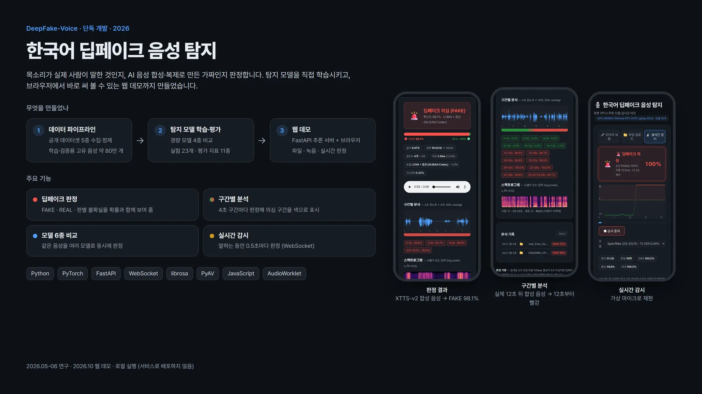
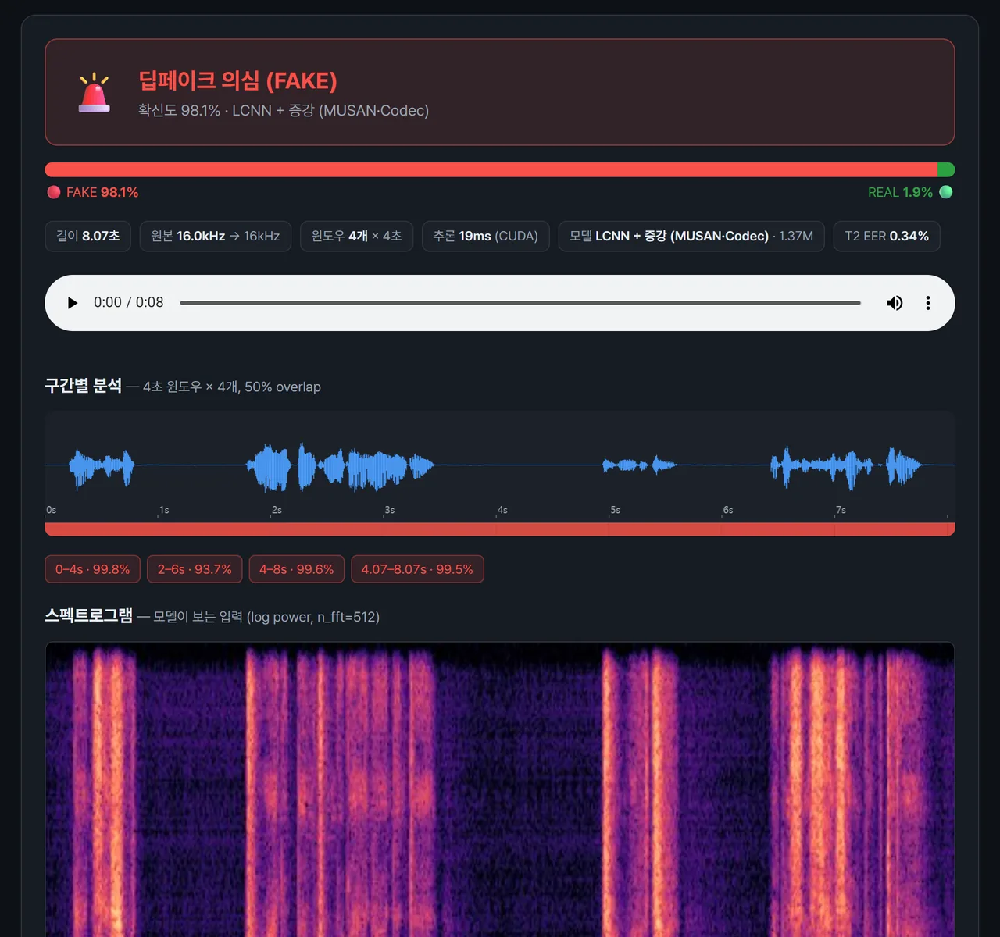
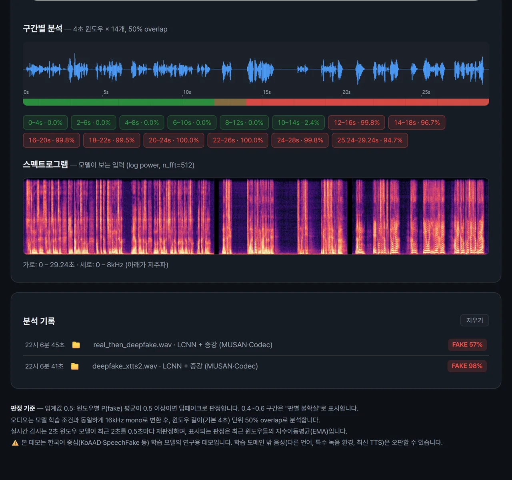
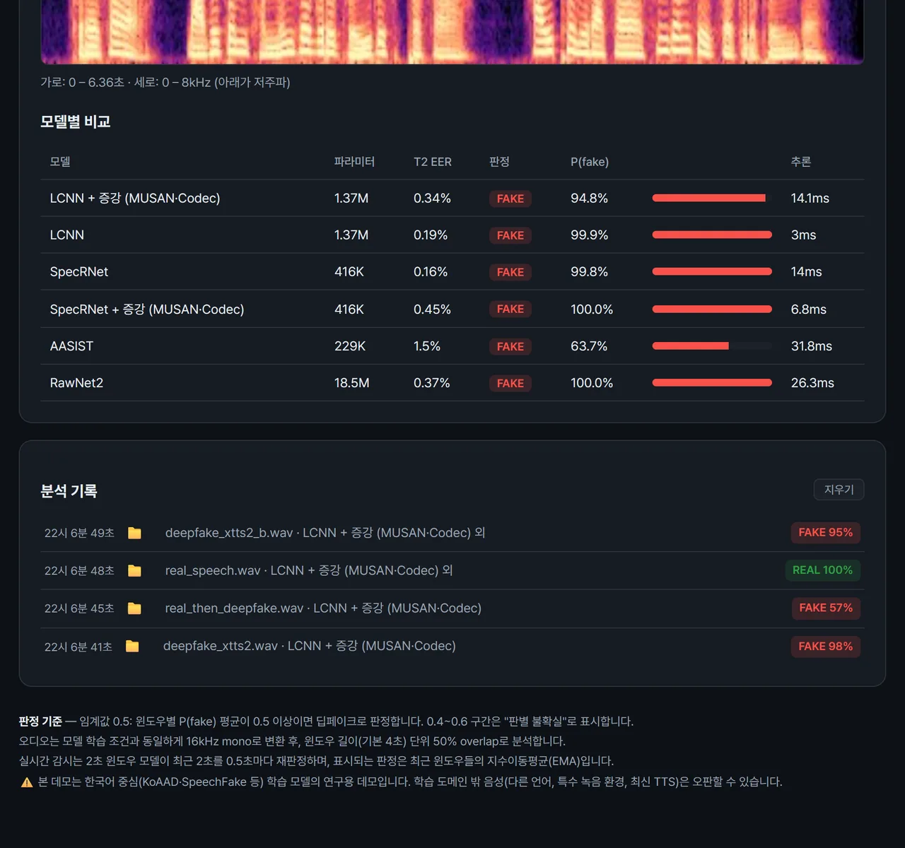
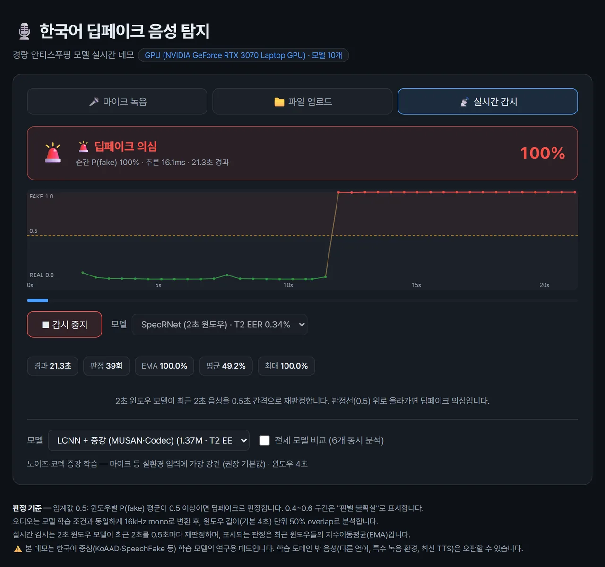
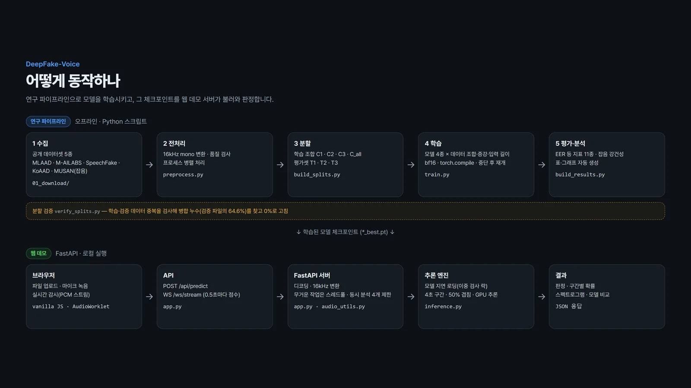

# DeepFake-Voice · 한국어 딥페이크 음성 탐지

목소리가 실제 사람이 말한 것인지, AI 음성 합성·복제(TTS, 보이스 클로닝)로 만든 가짜인지 판정하는 탐지 모델과 웹 데모입니다.

- 공개 음성 데이터로 경량 탐지 모델 4종을 직접 학습시키고 비교했습니다.
- 학습한 모델로 파일·마이크·실시간 음성을 판정하는 FastAPI 웹 데모를 만들었습니다.



> 연구용 로컬 데모입니다.
> - 서비스로 배포하지 않았습니다.
> - 오디오 데이터와 모델 가중치는 저장소에 없습니다.
> - 판정 성능의 한계는 [한계](#한계) 절에 정리했습니다.

## 무엇을 만들었나

| 단계 | 내용 | 주요 파일 |
|---|---|---|
| ① 데이터 파이프라인 | 공개 데이터셋 5종을 수집하고, 16kHz mono 변환과 품질 검사를 거쳐 학습 조합(C1·C2·C3·C_all)과 평가셋(T1·T2·T3)으로 나눕니다 | `scripts/01_download/`, `scripts/02_preprocess/`, `scripts/03_train/merge_manifests.py` |
| ② 탐지 모델 학습·평가 | AASIST·SpecRNet·LCNN·RawNet2를 데이터 조합·증강·입력 길이별로 학습합니다(체크포인트 23개). EER·minDCF 등 지표 11종과 잡음 강건성을 평가합니다 | `scripts/03_train/` |
| ③ 웹 데모 | FastAPI 서버(REST + WebSocket)와 브라우저 화면. 파일 업로드·마이크 녹음·실시간 감시로 판정합니다 | `webapp/` |
| ④ 분할 검증 | 학습·검증·평가 데이터의 중복을 검사합니다. 이 검사로 병합 누수를 찾아 고쳤습니다 | `scripts/04_analyze/verify_splits.py`, `docs/` |

사용한 데이터는 다음과 같습니다.
- MLAAD v9(다국어 합성), M-AILABS(다국어 실제 음성)
- SpeechFake-MD(한국어 합성·실제)
- KoAAD(한국어 합성)와 AI Hub 한국어 실제 음성
- MUSAN(잡음 증강용)

규모는 다음과 같습니다.
- 원시 파일 1,512,236개를 샘플링·품질 필터링해 1,002,528개로 정리했습니다([scripts/README.md](scripts/README.md)).
- 그중 학습·검증에 쓴 고유 파일은 796,714개입니다.
- 평가셋은 T1 982개, T2 26,977개, T3 116,544개입니다.

## 화면

| 판정 결과 | 구간별 분석 |
|---|---|
|  |  |
| 평가셋의 XTTS-v2 음성 복제 파일 → 딥페이크 의심 98.1% | 실제 음성 12초 뒤에 합성 음성을 이어 붙인 파일 → 12초부터 빨강 |

| 모델 6종 비교 | 실시간 감시 |
|---|---|
|  |  |
| 같은 파일을 6개 모델로 동시에 판정 | 브라우저 가상 마이크로 재현한 시연입니다. 같은 경로에서 실제 음성도 FAKE가 나와 성능 근거는 아닙니다([한계](#한계)) |

**기능**
- **파일 업로드 판정**
  - WAV·MP3·FLAC·OGG·M4A·WEBM을 60MB까지 받습니다. 5분 넘는 부분은 잘라서 분석합니다.
  - 16kHz로 바꾼 뒤 4초 구간(50% 겹침)마다 판정합니다.
  - 구간 평균 P(fake)가 0.5 이상이면 딥페이크로 판정하고, 0.4~0.6은 "판별 불확실"로 표시합니다.
- **구간별 분석과 스펙트로그램**: 어느 구간이 의심스러운지 색 띠로 보여 주고, 모델 입력과 같은 log power 스펙트로그램을 그립니다.
- **모델 선택과 비교**: 모델 10종 중 하나를 고르거나 6종을 동시에 돌려 비교합니다.
- **입력 품질 경고**: 거의 무음이거나 클리핑(소리 찢어짐)이 있으면 경고합니다.
- **마이크 녹음**: AudioWorklet으로 압축하지 않은 PCM을 받아 WAV로 보냅니다.
- **실시간 감시**: WebSocket으로 PCM을 보내면 서버가 최근 2초를 0.5초마다 판정합니다. 화면은 지수이동평균(EMA)으로 상태를 표시합니다.
- **API 문서**: 서버를 띄운 뒤 `/docs`에서 볼 수 있습니다.

## 동작 구조



- **`POST /api/predict`**
  - soundfile로 디코딩하고, 실패하면 PyAV로 디코딩합니다.
  - 16kHz로 변환한 뒤 스레드풀에서 추론합니다. 업로드 분석은 동시에 4개까지만 돌립니다.
  - 판정, 구간별 확률, 스펙트로그램을 JSON으로 돌려줍니다.
- **`WS /ws/stream`**
  - 클라이언트 샘플레이트를 16kHz로 리샘플합니다.
  - 최근 2초만 버퍼에 둡니다. 새 오디오가 0.5초 쌓이면 가장 최근 창 하나만 판정해서 지연이 쌓이지 않게 합니다.
- **추론 엔진**: 체크포인트를 처음 쓸 때 불러옵니다(이중 검사 락으로 한 번만). GPU 추론은 락으로 하나씩 처리합니다.
- 프로토콜과 동시성 설계는 [webapp/README.md](webapp/README.md)에 있습니다.

## 실행

### 1. 설치

```bash
pip install -r requirements.txt
```

```bash
pip install fastapi uvicorn python-multipart
```

GPU를 쓰면 [PyTorch 안내](https://pytorch.org/get-started/locally/)에 따라 CUDA 빌드의 `torch`를 먼저 설치합니다.

### 2. 데이터 준비 → 학습 → 평가

데이터셋 다운로드를 포함한 전체 순서는 [scripts/README.md](scripts/README.md)에 있습니다. 데이터를 받은 뒤의 핵심 단계는 다음과 같습니다.

```bash
python scripts/02_preprocess/preprocess.py scan --data-root ./data --meta-dir metadata
```

```bash
python scripts/02_preprocess/preprocess.py sample --meta-dir metadata --seed 42 --buffer 1.3
```

```bash
python scripts/02_preprocess/preprocess.py process --workers 8 --output-root processed --meta-dir metadata
```

```bash
python scripts/02_preprocess/build_splits.py --meta-dir metadata --output-dir manifests --seed 42
```

```bash
python scripts/03_train/merge_manifests.py
```

```bash
python scripts/04_analyze/verify_splits.py --json docs/split_verification.json
```

```bash
python scripts/03_train/train.py --all
```

```bash
python scripts/03_train/build_results.py --all --output experiments/results_v2.csv
```

```bash
python scripts/04_analyze/visualize.py --all --results experiments/results_v2.csv
```

- **`merge_manifests.py`**
  - 기본값은 수정한 병합 방식으로 `manifests/C_all`을 다시 만듭니다. 학습 설정(`configs/*_call*.yaml`)이 이 경로를 읽습니다.
  - 이전 결과를 남기려면 `--out-name C_all_v2`를 붙입니다.
  - 수정 전 방식은 `--legacy`로 재현합니다.
- **`verify_splits.py`**
  - 평가셋에 학습 파일이 섞여 있으면 종료 코드 1로 실패합니다.
  - `--json`에 준 폴더가 없으면 저장하다 오류가 납니다. 이미 있는 폴더를 지정하세요.
- **`train.py --all`**: 끝난 실험은 건너뜁니다. `--resume`으로 중단된 실험을 이어서 하고, `--force`로 다시 학습합니다.

### 3. 웹 데모

```bash
python webapp/app.py
```

- `http://127.0.0.1:8000`에서 엽니다.
- 학습한 체크포인트가 `experiments/checkpoints/*_best.pt`에 있어야 합니다. 체크포인트가 있는 모델만 화면에 나옵니다. 기본 모델은 `lcnn_call_aug_both_best.pt`입니다.
- 브라우저 정책 때문에 마이크는 localhost나 HTTPS에서만 동작합니다.

### 4. 테스트

```bash
python scripts/03_train/test_metrics.py
```

```bash
python scripts/03_train/verify_models.py
```

- `test_metrics.py`: 지표 함수 단위 테스트 20개
- `verify_models.py`: 모델 4종이 forward/backward를 통과하는지 확인합니다.

## 결과 요약

> ⚠️ **아래 EER은 최종 성능이 아니라 참고값입니다.** 데이터 분할을 고치기 전에 고른 체크포인트의 평가값입니다.
> - 검증 데이터의 64.6%가 학습과 겹친 상태에서 모델을 골랐습니다.
> - T2 평가셋 화자의 79.9%가 C_all 학습에도 있습니다.
> - 자세한 내용은 [docs/portfolio-verification.md](docs/portfolio-verification.md)와 [데이터_분할_명세.md](데이터_분할_명세.md)에 있습니다.
>
> 평가셋은 다음과 같습니다.
> - T1: SpeechFake 한국어 982개
> - T2: KoAAD 26,977개
> - T3: MLAAD 다국어 116,544개

**모델 비교** (전체 데이터 C_all로 학습, EER)

| 모델 | 파라미터 | 크기 | T1 | T2 | T3 |
|---|---:|---:|---:|---:|---:|
| AASIST | 229K | 0.9MB | 2.44% | 1.50% | 0.57% |
| SpecRNet | 416K | 1.6MB | 0.20% | 0.16% | 0.05% |
| LCNN | 1.37M | 5.2MB | 0.20% | 0.19% | 0.02% |
| RawNet2 | 18.5M | 70.7MB | 0.61% | 0.37% | 0.21% |

LCNN은 RawNet2보다 13배 작습니다. 같은 측정에서 약 3.3배 빨랐습니다(초당 830개 대 252개).

**학습 데이터 조합 비교** (LCNN, EER)

| 학습 조합 | 구성 | T1 | T2 | T3 |
|---|---|---:|---:|---:|
| C1 | 다국어(한국어 제외) | 62.95% | 76.37% | 0.00% |
| C2 | 다국어 + SpeechFake 한국어 | 0.20% | 57.35% | 0.01% |
| C3 | 한국어만(SpeechFake + KoAAD) | 0.20% | 0.43% | 81.30% |
| C_all | 전체 | 0.20% | 0.19% | 0.02% |

- 한국어가 들어 있어도 평가셋과 출처가 다른 데이터로만 학습하면(C2 → T2) 실패했습니다.
- 그래서 "데이터 양보다 출처의 다양성이 중요하다"고 봤습니다.
- 다만 C3·C_all은 T2와 화자가 많이 겹칩니다. 이 차이의 일부는 화자 중복 때문일 수 있습니다.

**잡음 강건성** (LCNN, EER)

| 조건 | T1 | T2 | T3 |
|---|---:|---:|---:|
| 깨끗한 음성 | 0.20% | 0.19% | 0.02% |
| 가우시안 잡음(진폭 0.001) | 4.13% | 66.14% | 46.92% |
| MUSAN 잡음 20dB | 26.48% | 24.16% | 5.37% |
| MUSAN 잡음 5dB | 49.49% | 36.17% | 8.83% |

아주 약한 잡음만 섞어도 성능이 크게 무너집니다. 이 모델의 가장 큰 약점입니다.

## 데이터 분할 검증: 발견한 문제와 수정

결과를 다시 검토하다가, 통합 학습 데이터(C_all)의 검증 파일 중 64.6%가 학습에도 들어 있는 것을 찾았습니다. 검증 점수로 학습 중단 시점과 최종 모델을 고르기 때문에, 모델 선택의 근거가 무너지는 문제였습니다.

| 항목 | 수정 전 C_all | 수정 후 |
|---|---:|---:|
| 학습 행 수 | 1,067,960 | 728,661 |
| 학습 고유 파일 수 | 734,862 | 728,661 |
| 학습 중복 행 비율 | 31.2% | 0% |
| 검증 파일 중 학습에도 있는 비율 | 64.6% | 0% |

- **원인**: 세 조합(C1·C2·C3)은 같은 파일을 공유합니다. 각자 따로 나눈 결과를 그대로 이어 붙여서, 같은 파일이 한 조합에서는 학습으로, 다른 조합에서는 검증으로 들어갔습니다.
- **수정**
  - 세 조합의 학습·검증 데이터를 한 풀로 모았습니다.
  - 파일 경로로 중복을 지운 뒤, 화자 그룹 단위로 다시 나눴습니다(`scripts/03_train/merge_manifests.py`).
  - 검증 스크립트(`scripts/04_analyze/verify_splits.py`)를 만들었습니다. 평가셋에 학습 파일이 섞이면 실패합니다.
- **남은 일**
  - 수정한 분할로 다시 학습하고 평가하는 일은 아직 하지 않았습니다.
  - T2 평가셋의 화자 분리 문제도 아직 풀지 못했습니다(T2 화자의 79.9%가 C_all 학습에도 있음).

## 한계

- **잡음과 녹음 경로에 약합니다.** 위 표처럼 약한 잡음에도 EER이 크게 오릅니다.
- **브라우저로 녹음한 실제 음성이 FAKE로 판정됐습니다.** 2026-11-25 로컬에서 확인했고, 재현 스크립트는 아직 저장소에 없습니다.
  - Chrome 가상 마이크로 실제 음성을 녹음해 판정하면 3번 모두 FAKE(80.5~99.2%)였습니다. 같은 파일을 업로드하면 0%입니다.
  - 원본 실제 음성에서 7.5~8kHz 대역만 잘라내도 대부분 모델이 FAKE로 바뀌었습니다.
  - 모델이 합성 흔적보다 고주파 끝 대역의 특징에 기대고 있는 것으로 보입니다.
  - 마이크·실시간 판정은 시연용으로만 봐야 합니다.
- **결과 수치는 분할을 고치기 전 기준입니다.** 위 [결과 요약](#결과-요약)을 참고하세요.
- **로컬 데모입니다.** 배포나 부하 시험을 하지 않았습니다. uvicorn 워커를 여러 개 띄우면 워커마다 모델을 GPU에 따로 올립니다.
- **결과가 없는 계획**
  - 외부 벤치마크(ASVspoof 2019·2021, In-the-Wild, CD-ADD)는 다운로드·변환 스크립트만 있습니다.
  - SSL 모델(XLS-R) 비교도 결과가 없습니다.

## 저장소 구조

```
├── scripts/
│   ├── 01_download/     데이터셋 다운로드 (9종)
│   ├── 02_preprocess/   전처리 · 학습 조합·평가셋 분할 · 외부 벤치마크 변환
│   ├── 03_train/        학습·평가 (train.py, models/, configs/, metrics.py, eval_noise.py …)
│   └── 04_analyze/      분석·시각화 · 분할 검증(verify_splits.py)
├── webapp/              FastAPI 웹 데모 (app.py, inference.py, audio_utils.py, static/)
├── docs/                분할 검증 기록, README 이미지
├── 데이터_분할_명세.md    학습·평가 분할 명세
├── RESEARCH_PHASES.md   연구 계획과 단계별 결과
└── requirements.txt
```

`data/`, `processed/`, `manifests/`, `experiments/`(체크포인트·결과)는 용량 때문에 저장소에 넣지 않습니다(`.gitignore`).

## 출처

- **데이터셋**
  - MLAAD v9, M-AILABS, SpeechFake-MD, KoAAD, MUSAN
  - AI Hub(감성 및 발화스타일 동시고려 음성합성 데이터)
  - 각 데이터셋의 라이선스를 따릅니다.
- **모델 구조**: 각 모델은 아래 논문의 구조를 따릅니다.
  - AASIST(Jung et al., ICASSP 2022)
  - RawNet2(Tak et al., 2021)
  - LCNN(Wu et al., Light CNN)
  - SpecRNet(Kawa et al., Interspeech 2022)
